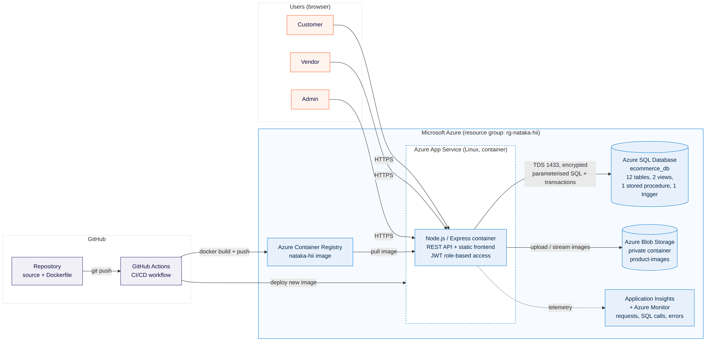
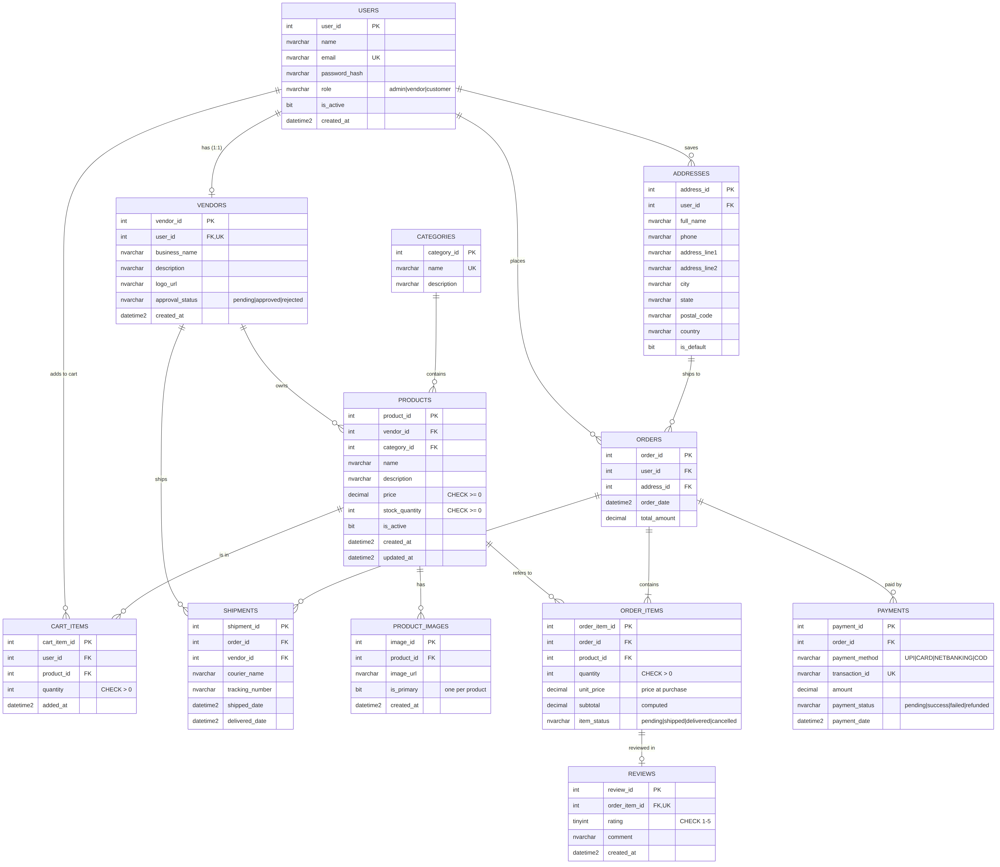

# Nataka Hii — Multi Vendor E-Commerce Platform

**Group 11 · AIE-B · DBMS + Cloud Computing project**

A marketplace where many independent stores sell through one website. Customers browse every store, use one cart and one checkout; each store ships its own items; an admin approves stores and manages the platform.



## Features by role

| Role | What they can do |
|---|---|
| **Customer** | Sign up, browse and search all stores, filter by category, sort by price or rating, view product photos and reviews, cart, save addresses, check out (UPI / card / net banking simulated, or cash on delivery), track each store's shipment, review delivered items (verified purchase only) |
| **Vendor** | Sign up (waits for admin approval), add / edit / delete products with up to 5 photos, see only their own items in each order, ship with courier + tracking number, mark delivered, sales report (revenue, best sellers, low-stock alert) |
| **Admin** | Platform stats, approve / reject stores, add / delete categories, activate / deactivate users, see all orders |

## Tech stack

| Layer | Technology | Azure service |
|---|---|---|
| Frontend | HTML, CSS, vanilla JavaScript (no build step) | served by the same App Service |
| Backend | Node.js 20, Express 5, JWT auth, bcrypt | **Azure App Service** (Linux container) |
| Database | SQL Server / T-SQL | **Azure SQL Database** |
| Images | Private blob container | **Azure Blob Storage** |
| Container | Docker | **Azure Container Registry** |
| CI/CD | GitHub Actions | builds → ACR → App Service |
| Monitoring | Application Insights SDK | **Application Insights + Azure Monitor** |

## Database (DBMS)



- **12 tables** in 3NF: users, vendors, categories, products, product_images, addresses, cart_items, orders, order_items, payments, shipments, reviews
- **Constraints:** primary keys, 15 foreign keys, UNIQUE (email, one review per item, one cart row per product…), CHECK (price ≥ 0, stock ≥ 0, rating 1–5, status values), a filtered unique index (one cover photo per product), a computed column (`order_items.subtotal`)
- **Views:** `vw_product_catalog`, `vw_order_overview` (order status derived from item statuses)
- **Stored procedure:** `sp_vendor_sales_report`
- **Trigger:** `trg_products_updated_at`
- **Transactions:** signup, checkout (stock check + order + items + payment + clear cart), shipping, delivery, product save/delete
- Full schema: [`db/schema.sql`](db/schema.sql) · demo queries: [`db/queries.sql`](db/queries.sql) · report notes: [`docs/DBMS_NOTES.md`](docs/DBMS_NOTES.md)

## Run locally (Docker)

```bash
docker compose up --build
```

Open **http://localhost:8080**. The first start takes about a minute while SQL Server boots and the app creates the tables and demo data.

> On an Apple Silicon Mac, turn on *Use Rosetta for x86/amd64 emulation* in Docker Desktop settings first (SQL Server has no ARM image).

Reset the database to the demo data at any time:

```bash
docker compose exec app npm run db:reset
```

### Demo accounts

| Role | Email | Password |
|---|---|---|
| Admin | admin@natakahii.com | admin123 |
| Vendor (approved) | rahul@example.com | vendor123 |
| Vendor (approved) | priya@example.com | vendor123 |
| Vendor (pending approval) | meena@example.com | vendor123 |
| Customer | anita@example.com | customer123 |
| Customer | karthik@example.com | customer123 |

The login page has one-click buttons to fill these in.

## Deploy to Azure

In Azure Cloud Shell, from the cloned repo:

```bash
SUFFIX=g11aieb bash azure/deploy.sh
```

This creates every resource (SQL, Storage, App Insights, ACR, App Service), builds the image, configures the app and prints the GitHub Actions secrets. Full guide and manual steps: [`docs/AZURE_DEPLOYMENT.md`](docs/AZURE_DEPLOYMENT.md)

## Project structure

```
├── Dockerfile                  # one image: API + frontend + schema
├── docker-compose.yml          # local SQL Server 2022 + app
├── .github/workflows/deploy.yml# CI/CD to Azure
├── .env.example                # every setting the app reads
├── azure/
│   ├── deploy.sh               # one-command Azure provisioning + deployment (IaC)
│   └── cleanup.sh              # delete all Azure resources
├── db/
│   ├── schema.sql              # tables, constraints, indexes, views, procedure, trigger
│   └── queries.sql             # joins, aggregates, subqueries, window functions, constraint + transaction demos
├── backend/
│   ├── server.js               # Express app, App Insights, static frontend, /images
│   ├── lib/db.js               # Azure SQL pool, parameterised query + transaction helpers
│   ├── lib/storage.js          # Azure Blob Storage (or local disk)
│   ├── lib/init-db.js          # creates schema + demo data (npm run db:init / db:reset)
│   ├── lib/errors.js           # maps SQL constraint errors to clean API errors
│   ├── middleware/auth.js      # JWT + role-based access control
│   └── routes/                 # auth, categories, products, vendor, customer, admin
├── frontend/                   # index (store), login, signup, orders, vendor, admin
└── docs/                       # ER + architecture diagrams, Azure guide, DBMS notes
```

## API summary

| Method | Path | Who |
|---|---|---|
| POST | `/api/auth/signup`, `/api/auth/login` | anyone |
| GET | `/api/products`, `/api/products/:id`, `/api/categories` | anyone |
| GET/POST/PUT/DELETE | `/api/customer/cart…`, `/api/customer/addresses`, `POST /api/customer/checkout`, `/api/customer/orders…`, `POST /api/customer/reviews` | customer |
| GET/POST/PUT/DELETE | `/api/vendor/products…`, `/api/vendor/orders…`, `/api/vendor/stats` | vendor |
| GET/PATCH | `/api/admin/stats`, `/api/admin/vendors…`, `/api/admin/users…`, `/api/admin/orders`; POST/DELETE `/api/categories` | admin |
| GET | `/api/health` | health check (database + storage) |
